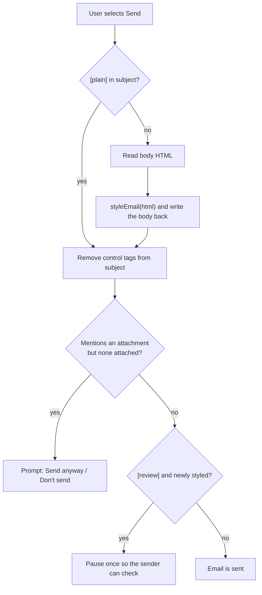

> **A.Y. edition.** A personal copy of D.E. Foxx Email Style (engine v35) with one addition: an optional
> personal reply signature (short name + tagline) set in Email style settings. It has its own add-in Id and
> must be hosted at the URL in `site/manifest.xml`; it does not receive updates from the team version.
> Changed files: `site/launchevent.js`, `site/taskpane.html`, `site/manifest.xml`, `site/install.html`,
> `tests/check-personal-reply.cjs`, `tests/check-brands.cjs`, `tests/run-all.cjs`.

# D.E. Foxx Email Style

An Outlook add-in that gives every email, reply and meeting invite you send your company's look: **D.E. Foxx & Associates** or **Versatex**. It works on **Send**: you write as usual, and the add-in restyles your part of the email just before it leaves. Recipients need nothing installed, because the styling is plain HTML inside the email.

It runs in **Outlook on the web** and **New Outlook for Windows**.

| | |
| --- | --- |
| **Install guide** | https://defoxxanalytics.github.io/email-style/install.html |
| **Live add-in** | https://defoxxanalytics.github.io/email-style/ (published from `site/` by GitHub Actions) |
| **Current version** | engine `launchevent.js?v=34`, manifest `1.0.0.0`, add-in Id `965d12db-94ce-4f1a-a25b-069ec2fa6665` |
| **Tests** | `npm test`: 281 checks plus older suites and a re-send stability check |

> **Every push to `main` goes live.** GitHub Actions runs the tests and the manifest check, then publishes `site/` to GitHub Pages. Outlook loads the add-in from there, so a change reaches every user's Send button about 10 minutes later.

## Contents

- [What it does](#what-it-does)
- [Which company look each person gets](#which-company-look-each-person-gets)
- [Install](#install)
- [Using it](#using-it)
- [Privacy and safety](#privacy-and-safety)
- [How it works](#how-it-works)
- [Repository layout](#repository-layout)
- [Development](#development)
- [Publishing a change](#publishing-a-change)
- [Outlook rendering rules](#outlook-rendering-rules)
- [Design rules](#design-rules)
- [Known limits](#known-limits)
- [Version history](#version-history)

## What it does

When you select Send, the add-in:

1. **Frames the email.** A 6px ink band with a yellow rule goes on top, and a signature panel goes at the bottom: your company's logo, your name, title and phone, and your company's motif (the gold X for D.E. Foxx, the hexagon cluster for Versatex). Later replies in a thread that already carries your signature get a one-line signature instead.
2. **Tidies the text.** Outlook's default look becomes Roboto/Arial 15px in brand ink. Formatting you chose on purpose (a colour, a size, code) is kept.
3. **Brands lists and tables.** Bullets become grey hexagons (lighter when nested), top-level numbered lists get yellow number badges, and tables you insert get a black header with a yellow rule and light stripes. Tables pasted from elsewhere keep their own colours.
4. **Applies smart formatting** to a few patterns you type (see [Using it](#using-it)): headings, callouts, KPI tiles, timed agendas, link buttons, status tags and key figures.
5. **Checks for a missing attachment.** If your own text says "attached" or "enclosed" and nothing is attached, Send asks first.

Only the part you wrote is touched. The quoted thread under a reply or forward is never changed. Meeting invites get the same treatment when you send them as the organiser.

## Which company look each person gets

Both companies share the same palette, fonts, band, lists and tables. Only the signature panel differs:

| Company | Signature panel |
| --- | --- |
| D.E. Foxx & Associates | Stacked D.E. Foxx logo on the left, gold X on the right |
| Versatex | Stacked Versatex logo on the left, hexagon cluster on the right |

- Until someone saves their signature, the company comes from their email address: `@versatexmsp.com` gets Versatex, every other address gets D.E. Foxx.
- Anyone can change it under **Company** in **Email style settings**; the choice is saved with their signature and wins over the address.
- To send another domain to Versatex, add it to `BRAND_BY_DOMAIN` in `site/launchevent.js`.
- To add a company, add an entry to `SIGNATURE_BRANDS` (logo and motif images in `site/assets/`, drawn at 2× for sharp screens), an `<option>` in the pane's Company menu and a header logo in the pane's `HEADER_LOGOS`. `tests/check-brands.cjs` checks that these stay in step.

## Install

1. Open the [install guide](https://defoxxanalytics.github.io/email-style/install.html) and download the add-in file (`manifest.xml`).
2. Go to [aka.ms/olksideload](https://aka.ms/olksideload). Outlook on the web opens, and after a few seconds the **Add-Ins for Outlook** window appears.
3. Select **My add-ins**, scroll to **Custom Addins**, then **Add a custom add-in › Add from File**. Choose the downloaded file and accept the prompts.
4. Restart New Outlook, or refresh Outlook on the web.
5. Start a new email. A banner asks you to **Finish your email signature**. Select **Open settings**, check your company and name, add your title and phone, and save.

You can reopen the settings any time from a new email: **Apps › Email style settings**.

> **If step 2 only opens your inbox,** Microsoft's add-ins page is having a known problem ([office-js #6625](https://github.com/OfficeDev/office-js/issues/6625)). It broke this way in April 2026 and again in November 2026. Try again later, or ask IT to deploy the add-in (below).

**Updates are automatic.** Outlook loads the add-in's code from the live site every time, so nobody reinstalls for a new version. The settings pane header shows the running version. Only changes to the add-in file itself (new buttons or events) need a re-add or, for IT deployments, an update in the admin center.

**Already added Versatex Email Style, or this add-in from another link?** Remove that copy first, so emails aren't styled twice. This is a separate add-in, so you enter your signature once more.

**To remove the add-in:** in Outlook on the web, select **More apps** in the left bar, then **Add apps › Manage your apps**, choose **…** next to D.E. Foxx Email Style, then **Remove**.

### Deploying through IT

Microsoft officially supports event-based (on-Send) add-ins only when an admin deploys them, and then nobody has to install anything. One deployment covers both companies. An admin in the Microsoft 365 admin center:

1. Goes to **Settings › Integrated apps**, selects **Add-ins** near the top, then **Deploy Add-in** and **Next**.
2. Chooses to upload a custom add-in, picks the URL option, enters `https://defoxxanalytics.github.io/email-style/manifest.xml` and selects **Upload**.
3. Chooses **Everyone**, **Specific users/groups** or **Just me**, then **Deploy**. It can take 24 to 72 hours to appear in Outlook.

When the add-in file changes later, the admin selects the add-in and chooses **Update**. People who installed it themselves should remove their own copy (marked Custom app) if it then appears twice.

## Using it

### Type this, get this

| You type | Recipients see | Switch |
| --- | --- | --- |
| A short line in **bold**, on its own | A section heading with a yellow rule | `headings` (on) |
| A short plain line between paragraphs (up to 6 words, starts with a capital, no closing punctuation) | A section heading, for titles pasted without bold | `plainTitles` (**off**) |
| `Action:` `Decision:` at the start of a line | A callout with the label on a small ink tag | `callouts` (on) |
| `Deadline:` `Important:` `Ask:` `Risk:` | A callout with an ink label and a yellow edge | `callouts` (on) |
| `Note:` `FYI:` `Reminder:` `Next steps:` | A callout with a grey label and edge | `callouts` (on) |
| `KPI: Spend $4.1M -8% [On track] \| Margin 18%` | A row of big-number tiles (up to 3 per row) | `kpis` (on) |
| Two or more lines like `10:00 Welcome` / `10:15-10:45 Q3 review` | A timed agenda table with durations | `agenda` (on) |
| A link on its own line | A black button with a smart label (for example "Open Power BI report") and the domain. A link whose address could mislead stays a plain link | `buttons` (on) |
| `[On track]` `[At risk]` `[Off track]` `[Done]` `[Blocked]` `[In progress]` `[Not started]` `[Complete]` `[Completed]` | A small coloured status pill | `statuses` (on) |
| `6%` `$1.2M` `$14–16` `10–20%` | Key figures in bold on a light yellow highlight. With more than 8 figures in the email, they are bold only | `figures` (on) |
| `@` and pick a colleague | Their name as a tag. Outlook on the web draws its own chip over it, so this is off by default; the person is notified either way | `mentions` (**off**) |
| "attached", "attachment" or "enclosed" with nothing attached | Send asks **Send anyway / Don't send**. A SharePoint or OneDrive link counts as attached | `attachmentCheck` (on) |
| A reply in a thread you already signed | A one-line signature (name \| title \| phone) | `shortReplies` (on) |

KPI arrows show direction only and are always black. Green, amber and red come only from a status tag you add, because for spend metrics "down" is often good news.

### Subject tags

| Tag | Effect |
| --- | --- |
| `[review]` | Send pauses once after styling so you can check the result, then you select Send again |
| `[plain]` | The email goes exactly as typed |

Both tags are removed from the subject before the email goes out.

### Buttons and settings

In a new email or invite, the **Email style** group has two buttons:

- **Apply email style** restyles the draft now, so you can see the result before sending.
- **Email style settings** opens the settings pane:
  - **Signature:** company, name, title and phone, with a phone-width preview. The header logo follows the company.
  - **Formatting:** one switch per feature, saved as soon as you flip it, each with an example drawn by the real engine.
  - **Help:** the cheat sheet above.

The pane follows Outlook's dark theme when Outlook reports it, otherwise the system setting. Its header shows the running version ("Active · v35").

Settings are stored in Outlook `roamingSettings`, so they follow your mailbox across devices:

- `vstxSignature`: `{ name, title, phone, brand }`, where `brand` is `defoxx` or `versatex`. With nothing saved, the name comes from your Outlook profile ("Last, First" is flipped to "First Last") and the company from your address.
- `vstxFeatures`: the switches in the table above.

## Privacy and safety

- **Everything runs inside Outlook.** The engine (`site/launchevent.js`) is plain JavaScript with no network calls of its own. There is no server, no database and no third-party service. Your email content never leaves Outlook because of the add-in.
- **Permissions:** `ReadWriteItem`, the minimum needed to read and rewrite the email you are sending.
- **What is fetched:** Outlook loads the add-in files from GitHub Pages, and Microsoft's `office.js` from Microsoft's CDN. Recipients' mail clients load the logo and motif images from GitHub Pages, like any image in an email.
- **No lost words:** before anything is sent, the styled text is compared word by word with what you wrote. If styling would drop a word, your part goes out with fonts and colours only. If even that would lose a word, it goes out exactly as written.
- **Buttons never name the wrong site:** a link that hides its real destination (a user name before `@`, as in `https://sharepoint.com:x@evil.example`, or lookalike letters in the site name) is left as a plain link rather than turned into a button.
- **Send is never stuck:** if styling fails, Outlook offers to send the email as it is. A failed attachment lookup never blocks Send.
- **Re-sending is safe:** a styled draft is recognised by its `vstx-` markers, and only the text between the bar and the signature is re-tidied.

> **Who can change it.** The add-in reads and rewrites every email its users send, and anything pushed to `main` reaches them within minutes. This repository belongs to the shared DefoxxAnalytics GitHub account, so anyone with that login can publish a change. Keep the login to the people who maintain the add-in, and review every change before it is pushed.

## How it works

### Manifest

`site/manifest.xml` registers:

| Launch event | Handler | Purpose |
| --- | --- | --- |
| `OnNewMessageCompose`, `OnNewAppointmentOrganizer` | `onNewComposeHandler` | First-use banner until a signature is saved |
| `OnMessageSend`, `OnAppointmentSend` (SoftBlock) | `onMessageSendHandler` | Style the email, clean the subject, check attachments |

It also adds the **Apply email style** (`previewStyle`) and **Email style settings** (`taskpane.html`) buttons to the message compose and appointment organizer surfaces. The add-in needs Mailbox requirement set 1.12. "Send anyway" prompts use 1.14 where available.

`commands.html` loads `launchevent.js` and must call `Office.onReady()`, otherwise the Send handler hangs.

### What happens on Send



`styleEmail(html)` in [`site/launchevent.js`](site/launchevent.js):

1. Splits the body at the first quote marker (`findQuoteStart`): `#appendonsend`, `#divRplyFwdMsg`, `<hr>`, the `#E1E1E1` top border, the Teams underscore divider or `me-email-*`. Everything from there on is left untouched.
2. Restyles the sender's part through `safeRestyle`, which runs the pipeline and checks that no word is lost:

   ```
   restyleOwnPart = markInsertedTables → brandText → smartFormat → brandTables → withListTables
   ```

   | Step | Job |
   | --- | --- |
   | `markInsertedTables` | Tells tables inserted in Outlook apart from pasted ones (pasted keep their colours) |
   | `brandText` | Replaces Outlook's default font, size and colour; keeps deliberate formatting and code |
   | `smartFormat` | Agenda, headings, callouts, KPI tiles, buttons, mentions, status tags, key figures |
   | `brandTables` | Ink header, yellow rule and stripes on inserted tables |
   | `withListTables` | Turns `<ul>`/`<ol>` into hexagon and number-badge tables, including odd pasted list shapes |

3. Adds the brand bar and the full or one-line signature. The full panel takes its logo and motif from `SIGNATURE_BRANDS`, for the company in `signatureDetails()`. If the email is already framed, only the text between bar and signature is re-tidied.

Every generated element carries a `vstx-` class or id, so later passes skip it.

## Repository layout

```
.
├── site/                        published to GitHub Pages as is
│   ├── launchevent.js           the engine: styling pipeline, company looks and Outlook event handlers
│   ├── commands.html            function file; loads launchevent.js?v=N and calls Office.onReady()
│   ├── taskpane.html            settings pane (company, signature, switches, examples, help)
│   ├── install.html             install guide for colleagues
│   ├── index.html               sends the bare site address to the install guide
│   ├── manifest.xml             the add-in file people install or IT deploys
│   ├── assets/                  signature logos and motifs for both companies (used in emails), header logos, add-in icons
│   └── fonts/                   Roboto (OFL) for the settings pane and install guide
├── tests/
│   ├── run-all.cjs              runs every suite (npm test)
│   ├── check-*.cjs              suites, loaded against site/launchevent.js in a Node vm
│   ├── check-brands.cjs         which company look each sender gets, and that its images exist
│   ├── check-hardening.cjs      edge cases: Outlook failures, generated emails, injection, damaged settings
│   ├── diff-resend.cjs          sending twice gives the same email
│   ├── render-*.cjs             write previews to tests/preview/ (git-ignored)
│   └── serve-static.cjs         serves the previews locally
├── .github/workflows/deploy.yml tests every push and pull request; publishes site/ from main
├── server.mjs                   HTTPS dev server for site/ on port 3000
└── package.json
```

**Images in `site/assets/` are linked from sent emails. Never rename or delete one that has been published,** or the logos in earlier emails break. Add a new file name instead.

## Development

### Prerequisites

- Node.js 22
- Outlook on the web or New Outlook with a Microsoft 365 work account, for real-email checks

### Setup

```bash
git clone https://github.com/DefoxxAnalytics/email-style.git
cd email-style
npm install
```

### Scripts

| Command | What it does |
| --- | --- |
| `npm test` | Runs every suite against `site/launchevent.js`; exits 1 on any failure |
| `npm run validate` | Validates `site/manifest.xml` with `office-addin-manifest` (uses Microsoft's online validation service) |
| `npm start` | Serves `site/` at `https://localhost:3000` with Office dev certificates |

`npm start` is of limited use: Chrome's Local Network Access blocks Outlook on the web from loading `localhost`, so real testing goes through GitHub Pages.

### Previewing how recipients see it

```bash
node tests/render-smart.cjs site/launchevent.js     # also render-kpi.cjs, render-pasted.cjs
node tests/serve-static.cjs tests/preview 3101      # then open http://localhost:3101
```

- **Browser and phone:** view the previews at full width and at 375px.
- **Classic Outlook:** classic Outlook renders with Word's engine. Open the rendered `*-word.html` in Word and export it to PDF to see what classic Outlook readers will see.
- **Real emails:** send a test to yourself and read it in Outlook on the web, New Outlook and on a phone.

### Conventions

- Add or update a check in `tests/` for every behaviour change, and keep `npm test` green.
- Make regex edits in an editor, not through shell heredocs: some shell tooling strips backslashes, and `\b` inside a JS template literal becomes a backspace character.
- Before agreeing that a new version looks worse, render the **same** draft through both versions.

## Publishing a change

1. Edit `site/` and run `npm test`.
2. Bump `launchevent.js?v=N` in **both** `site/commands.html` and `site/taskpane.html` (a check fails if they differ). Outlook and GitHub Pages cache files for about 10 minutes, and the new number forces a fresh copy. The settings pane header shows this number.
3. Push to `main`, or open a pull request and merge it. The **Test and publish** workflow runs the tests and the manifest check, then publishes `site/`. Nothing is published if a check fails. If Microsoft's validation service is down, re-run the workflow later.
4. Wait about 10 minutes after the workflow finishes before testing in Outlook.

**Manifest changes** (new events, buttons or labels): bump `<Version>` in `site/manifest.xml` and run `npm run validate`. People who installed it themselves re-add the add-in from the install guide; for an IT deployment, the admin selects **Update** in the admin center. Saved settings survive a re-add.

**First publish only:** in the repository's **Settings › Pages**, set **Source** to **GitHub Actions**.

## Outlook rendering rules

Each Outlook client strips or rewrites different HTML, which drives most of the engine's design.

- **Classic Outlook (Word engine):**
  - It draws its own "•" on every `<li>` whatever the CSS says, so lists are tables.
  - It ignores table margins and merges neighbouring tables, so spacing uses spacer rows (`ruleCell`: font-size = line-height = height plus `mso-line-height-rule:exactly`) or `vstx-space` wrapper divs.
  - Borders on spans are dropped; backgrounds on spans survive.
- **Outlook on the web:**
  - It drops `text-transform`, so labels are written in capitals in the markup.
  - It drops `padding-left` on `<li>`.
  - It places sub-lists between items rather than inside them.
  - It re-colours bare text inside generated cells with the user's default blue, so text in generated cells is always wrapped in an ink-coloured element.
  - It swaps @mention links for its own persona chip when the email is read.
  - It strips class names (and `mso-` properties) from an email it displays. Text copied from a styled email therefore brings the add-in's tables without their `vstx-` classes. Most of them carry a background colour, so they count as pasted and are left alone; bullet lists don't, so any table holding the hexagon bullet (`HEXAGON_BULLET`) counts as the add-in's own list.
  - When the email is read, it strips `border-bottom` and `padding-bottom` from inline spans. That is why key figures use a background highlight: backgrounds on spans and full borders on inline-blocks (status tags) survive.
  - Text pasted from documents arrives as odd list shapes: bullets indented twice become a list inside a list with no item, and lines can sit inside a list outside any item. `attachParentlessLists` and `topLevelItems` handle both.
- **Images:** emails can't use SVG, so logos and motifs are PNGs drawn at twice their display size.
- **Weight 700, never 900:** mail clients don't load Roboto, and on Windows Arial at weight 900 becomes Arial Black.
- **Rounded corners** show in Outlook on the web, on phones and in Gmail; classic Outlook draws them square.

## Design rules

These are deliberate decisions. Keep them unless the team agrees a change.

- **Brand:** D.E. Foxx and Versatex share one palette: ink `#231f20`, yellow `#fdc00f`, greys `#58595b` and `#a7a9ac`, Roboto with Arial fallback. Yellow is used only for fills, rules and markers, never for text.
- **Frame ("Design B"):** 6px ink band with a yellow rule from 9% to the edge; signature panel with the company's stacked logo on the left and its motif on the right (D.E. Foxx: gold X; Versatex: hexagon cluster). Emails do not get a baked-in dark background.
- **Lists:** grey hexagon bullets for both companies (`#58595b`, then `#a7a9ac` deeper); yellow number badges on top-level numbered lists only.
- **Restyle defaults only:** text the sender formatted on purpose keeps its look; code keeps its font and size.
- **No automatic red/green:** KPI colour comes only from a status tag the sender adds.
- **Key-figure limit is per email:** more than 8 figures means bold only, across the whole email.
- **Spacing in 8px steps;** 6px corners, 10px status pills, 4px number badges.

## Known limits

- Emails written in the **Outlook phone app** aren't styled: mobile Outlook can't run on-Send add-ins. Received emails look fine on phones.
- **Classic Outlook for Windows** isn't a supported sending client. How styled emails look to classic Outlook readers has been checked only through Word renders, not in the real app.
- Emails aren't adapted for **dark mode** readers; transparent images were chosen over baked backgrounds. The settings pane does follow dark mode.
- After a `[review]` pause, pressing Enter inside a styled list adds a line, not a new bullet.
- A horizontal line (`<hr>`) in your own text is read as the start of a forwarded thread, so the signature goes above it and the text below isn't styled.
- Lettered or roman numbered lists (`a, b, c`, `I, II`), reversed lists and lists that skip numbers go out numbered 1, 2, 3; a start number is kept.
- A `[review]` or `[plain]` tag already in someone else's subject (replying to "[Review] Contract") acts as if you had typed it.
- The plain section titles switch (off by default) slows down on very large emails.
- When the safety net falls back to basic styling, the sender isn't told and Send doesn't pause.
- An email with more than 8 key figures gets no highlight at all. This is deliberate.
- **Self-installing** depends on Microsoft's add-ins page (aka.ms/olksideload), which has broken more than once. IT deployment is the supported route.

## Version history

The engine started as the Versatex Email Style add-in and was copied here at v34.

| Version | Date | Change |
| --- | --- | --- |
| v11–v23 | 2026-11-05 | Design B frame and signature, hexagon and number-badge lists, deliberate formatting kept, subject tags, settings pane, branded tables, meeting invites |
| v24 | 2026-11-05 | Smart formatting: headings, callouts, key figures, link buttons, status tags, feature switches |
| v25 | 2026-11-06 | Classic Outlook fixes (lists as tables, spacer rows), short reply signature, attachment reminder, KPI tiles |
| v26 | 2026-11-06 | Capital labels, @mention tags, timed agenda, ready for colleagues (profile name, first-use prompt, install guide) |
| v27 | 2026-11-06 | @mention tags off by default |
| v28 | 2026-11-06 | Pasted lists, no-lost-words safety net, ranges as one figure |
| v29 | 2026-11-06 | Key figures highlighted instead of underlined |
| v30 | 2026-11-16 | Modern look (weight 700, lighter callouts, rounded corners, 8px spacing, smaller signature); settings pane with tabs, instant-save switches, live examples, dark mode and a version label |
| v31 | 2026-11-16 | A bullet list copied from an earlier styled email stays a list |
| v32 | 2026-11-16 | Plain section titles switch (off by default) |
| v33 | 2026-11-17 | Security fix: links that hide their real site stay plain links instead of becoming buttons labelled with the wrong site |
| v34 | 2026-11-20 | This repository: D.E. Foxx Email Style, with a D.E. Foxx or Versatex signature panel per sender, its own site and install guide, a new add-in Id (manifest 1.0.0.0), and publishing through GitHub Actions after the tests pass |
| v35 | 2026-11-20 | Edge-case fixes from a full review, guarded by a new suite (check-hardening.cjs). Nothing the sender wrote is lost: two links on one line stay two links instead of becoming one button; bold lines, KPI lines and buttons keep their links, @mentions and pictures; an all-bold list or table stays a list or table. A button never shows one site and opens another. A pasted part of a received styled email no longer switches off your own frame. Word's quoted font names and characters such as ’ or é in headings come through intact. CSS no longer sets off the attachment reminder. 'Last, First (note)' becomes 'First Last (note)'. Styling an email again changes nothing. Large emails style in a fraction of a second (1.9 MB: 12.6 s before, 0.3 s now). Send always finishes exactly once, even when Outlook misbehaves |

---

Built by Analytics & AI Solutions.
